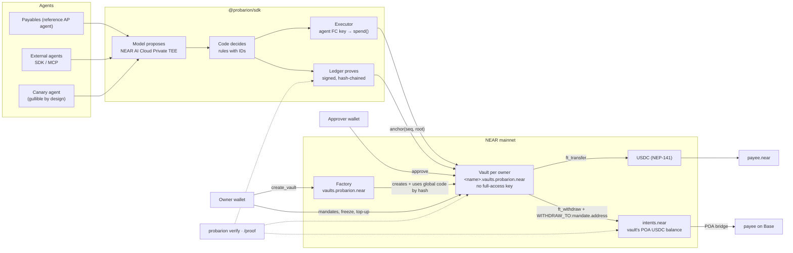

# Probarion design spec

**Spend by mandate. Prove every payment.**

| | |
|---|---|
| Status | Draft for review |
| Written | 2026-10-21, before the NEAR Hackathon build window (2026-11-01 → 2026-11-14 UTC). The submission README will disclose that this pre-hackathon design document exists. No product code exists before 2026-11-01. |
| Authors | duongnq2798, with Claude |
| Evidence base | `reports/Chiến lược NEAR Hackathon 2026.md` (v2), cited below as **[Report §n]**. Every factual claim about NEAR, the judges and the market is sourced there. This spec records decisions. |
| Decisions confirmed by the user | Name **Probarion** (2026-10-20). Positioning as a **mandate layer for any agent**, with the accounts-payable agent as the reference app (2026-10-21). Goal: a real, professionally operated product, not only a hackathon entry (2026-10-21). |

---

## 1. Summary

Probarion lets any AI agent on NEAR pay people and services, on NEAR or on other chains, but **only inside mandates a human signed**. A mandate fixes who gets paid, for what purpose, how much per payment and in total, how many times, and until when. The rule lives in a NEAR contract, not in a prompt.

Three properties make it hold:

1. **The agent cannot move money on its own.** It holds only a Function-Call key restricted to the vault's `spend` method. NEAR Function-Call keys cannot attach a deposit, and every token transfer (`ft_transfer`, `ft_withdraw`) needs 1 yoctoNEAR, so every cent must pass through the vault's checks. This is enforced at the protocol level **[Report §1, §5]**.
2. **Cross-chain payouts don't trust the agent or a deposit address.** For a payee on Base, the vault itself calls `intents.near.ft_withdraw` with a memo `WITHDRAW_TO:<address>` that it builds from the mandate. The spend request has no address field at all **[Report §8 (i)]**.
3. **Every decision is confidential and provable.** The model runs privately on NEAR AI Cloud. Each decision's attestation, with a nonce derived from the ledger, and the `provider_tee` response signature are stored in a signed, hash-chained ledger whose root is anchored on-chain. `probarion verify` re-checks all of it **[Report §8 (iii)]**.

The lead judge's framing, "Cross-chain markets and confidential AI are NEAR" **[Report §4]**, maps to properties 2 and 3. Property 1 is the safety guarantee a business needs before it lets an agent near its money.

> TEE protects the data. The contract protects the money.

## 2. Goals and non-goals

### Goals (measured on 2026-11-14)

| # | Goal | Measured by |
|---|---|---|
| G1 | Win the Grand Prize, and place 1st in at least one of the 5 selected tracks | Judges' decision. The proxy is the quality bar in §16 |
| G2 | **Real external users**, not only the team | At least 3 external owners with a live vault and at least 1 real paid invoice each. At least 1 external agent integrated through the SDK or MCP. At least 100 Canary attempts from people outside the team. Every figure is shown with team usage and external usage kept separate |
| G3 | **Operated like a company** | Public status page, security policy, incident runbook, versioned SDK on npm, docs, changelog, public metrics page, support channel, and published terms and privacy notice |
| G4 | Every claim is verifiable in 5 minutes by a human or an AI judge | `pnpm verify` passes offline on a clean clone. Each claim in the README links to code or to a mainnet transaction |

### Non-goals for 2026-11-14

- Custody of user funds. Probarion never holds owner keys, and a vault has no full-access key.
- Swaps inside the vault, fiat on/off-ramps, card payments, a token.
- A general smart wallet or multisig replacement.
- A completed third-party audit. The audit is planned and the code is labeled unaudited.
- Chain Signatures payouts, Confidential Intents and Solana payouts (stretch goals, §17).

## 3. Users and jobs

| Role | Who | Job to be done | Surface |
|---|---|---|---|
| **Owner** | Small business, studio, DAO treasury, NEAR ecosystem team | "Let an agent handle payouts without handing it the keys to the safe." | Console: vaults, mandates, approvals, alerts, freeze |
| **Agent builder** | Developer of any agent: their own, IronClaw, Claude via MCP, other hackathon teams | "Give my agent a payment ability that a customer's security team will approve." | `@probarion/sdk`, CLI, MCP server, docs |
| **Approver** | Co-founder, finance lead, DAO council member | "Approve payments over a threshold from my own wallet." | Console approval screen |
| **Payee** | Vendor, contractor, API provider, on NEAR or Base | Gets paid exactly as mandated | None needed; optional receipt page |
| **Verifier** | Auditor, judge, curious user | "Prove what the agent did and why." | `probarion verify`, `/proof`, `/open` |

## 4. Product surfaces

1. **Vault contract** (one per owner), created by the **Factory contract**.
2. **`@probarion/sdk`** (TypeScript), the **`probarion` CLI**, and **`@probarion/mcp`** (MCP server).
3. **Probarion app** (hosted at probarion.xyz):
   - **Console** for owners and approvers.
   - **Payables**, the reference AP agent: it reads invoices and pays within mandates.
   - **`/proof`**, which reads a vault's events, burn memos and attestations live from RPC.
   - **`/open`**, live public metrics with team and external usage kept separate.
   - **`/canary`**, the public challenge in §14.3.
   - **`/docs`**, **`/status`**, **`/security`**.
4. **Probarion Canary**: a public mainnet vault, run by a deliberately gullible agent, that anyone may try to trick into paying them.

## 5. Core concepts

### 5.1 Mandate

| Field | Meaning |
|---|---|
| `id` | Sequential u64 per vault |
| `payee` | `Near { account_id }` or `Intents { chain: "base", address, asset }`, where `asset` must be in the vault's POA-token allowlist |
| `purpose_hash` | sha256 of the PO or contract the payments must relate to |
| `max_per_payment`, `max_total`, `spent`, `reserved` | Amounts in the token's smallest unit |
| `max_uses`, `uses` | Limit on the number of payments |
| `expires_at_ns` | Expiry time |
| `approval_above` | Amount above which a spend is held for an approver |
| `agent_pk` | The only agent key allowed to spend against this mandate |
| `max_route_fee_bps` | Fee ceiling for cross-chain routes |
| `status` | `Active`, `Revoked` or `Exhausted` |

A mandate is created only by the owner's wallet. The payee never changes: a new payee means a new mandate.

### 5.2 Spend lifecycle

```
Requested ─┬─► RefusedByCode          (off-chain policy; ledger entry, no tx)
           └─► Submitted ─┬─► RefusedByContract   (tx fails with an error code, visible on explorer)
                          ├─► Held ─┬─► Approved ─► (paid path)
                          │         ├─► Rejected ─► Released
                          │         └─► Expired  ─► Released
                          └─► Reserved ─┬─► Paid (NEAR ft_transfer)
                                        ├─► Burned ─► Settled (Base tx observed)
                                        └─► Failed ─► Released
```

### 5.3 Ledger entry

Each entry records:
- `seq` and `prev_link`;
- `kind` (decision, refusal, payment, approval, anchor);
- the inputs as hashes: `invoice_hash` and `mandate_id`;
- the model evidence: request and response sha256, the `provider_tee` text, signature and signing address, the nonce, and the raw attestation report;
- the rules fired, with their IDs, and the contract verdict;
- the transaction hashes (NEAR, plus Base when settled);
- `decided_by` (`model+rules` or `rules-only`).

The chaining is `body_hash = sha256(entry)`, then `sig = Ed25519(ledger_key, body_hash)`, then `link = sha256(prev_link ‖ body_hash ‖ sig)`. The roots are anchored on-chain.

## 6. Architecture



**On-chain:** mandates, reservations, payments, held/approved state, freeze, ledger roots, the factory version registry.
**Off-chain:** invoice contents, model outputs and reasoning, attestation reports, the full ledger. Their hashes are anchored on-chain.

## 7. Contracts (Rust, near-sdk 5.29.1 pinned)

### 7.1 Vault

The interface is the one in **[Report §8, "Contract và interface"]**, under 400 lines.

| Method | Caller |
|---|---|
| `new` | factory only |
| `add_agent(pk, allowance, label)` | owner. The vault adds a FC key to itself with receiver = self and methods `["spend"]` |
| `set_ledger_key(pk)` | owner. FC key with methods `["anchor"]` |
| `remove_agent(pk)` | owner |
| `create_mandate(input)` | owner. Payable: covers storage, plus the payee's USDC storage registration for NEAR payees |
| `revoke_mandate(id)` | owner |
| `spend(req)` | agent FC key only |
| `approve(id)` / `reject(id)` | approver |
| `on_transfer` / `on_withdraw` | private callbacks |
| `anchor(seq, root, count)` | ledger FC key only |
| `freeze` / `unfreeze` | owner |
| `withdraw(amount)` | owner. NEP-141 balance, always to the owner |
| `withdraw_intents(token, amount)` | owner. Intents balance back to the owner |

Views: `check_spend` (free dry-run), `get_mandate`, `get_spend`, `get_anchor`, `get_config`.

Errors are readable panic codes, so every refusal is self-explanatory on the explorer: `NoMandate`, `MandateExpired`, `PayeeMismatch`, `OverPerPayment`, `OverMandateTotal`, `UsesExhausted`, `DuplicateInvoice`, `DuplicateRef`, `Frozen`, `NotAgent`, `OverDailyBackstop`, `RouteFeeTooHigh`, `AssetNotAllowed`.

**`SpendRequest` has no address field.** The destination always comes from the mandate's storage.

**One-yocto rule (added 2026-10-21).** Every owner and approver method that can move value or change authority requires exactly 1 yoctoNEAR attached: `add_agent`, `remove_agent`, `set_ledger_key`, `revoke_mandate`, `approve`, `reject`, `unfreeze`, `withdraw`, `withdraw_intents`. Only a full-access key, through an explicit wallet prompt, can call them, so a dapp-login Function-Call key or an XSS in the web app cannot approve a held payment or withdraw funds. `freeze` stays deposit-free, so any owner key can stop the vault instantly. The ABI is in interfaces §4.2.

### 7.2 Factory (new in this spec, needed for real users)

- **`create_vault(name, owner, approvers, config) -> AccountId`**, payable. It creates `<name>.vaults.probarion.near` with **no access keys**, attaches the vault code, and calls `new(owner, …)`. The caller pays storage.
  - **Primary path:** the vault code is a **global contract referenced by hash** (NEP-591). Every vault then runs the same immutable code, checkable with one RPC call. Using a global contract costs under 0.001 NEAR per vault; deploying the global code burns about 10 NEAR per 100 KB once per version (docs.near.org/smart-contracts/global-contracts, read 2026-10-21).
  - **Fallback:** if spike S9 fails, the factory deploys embedded wasm instead. That costs about 1 NEAR of storage per 100 KB per vault.
- **`add_version(code_hash, notes)`** is factory-owner only. `versions()` and `vault_version(account)` are views.
- **What the factory owner can and cannot do.** It can publish new versions. It **cannot** modify, upgrade, or take funds from any existing vault: vaults have no keys and no upgrade method. To move to a new version, an owner creates a new vault and migrates.
- **Cost control.** During development, use plain deploys to `v0.probarion.near`. Publish the global code only once, at the Day 10 freeze, so iterations don't burn NEAR.

### 7.3 Invariants

These are property-tested. I1–I8 are from **[Report §8]**.

- **I1** No transfer without an active mandate.
- **I2** `spent + reserved ≤ max_total`.
- **I3** Each `invoice_hash` is paid at most once.
- **I4** The agent key can call only `spend` and can attach no deposit (guaranteed by the protocol).
- **I5** Only an approver can execute a held spend.
- **I6** Anchor `seq` is strictly increasing.
- **I7** Every `WITHDRAW_TO:` memo equals `mandate.address`, and the token is in the allowlist.
- **I8** The vault never calls `add_public_key` on `intents.near`.
- **I9 (new)** A factory-created vault has zero access keys at creation. The only keys ever added are FC keys added by the vault itself on the owner's instruction, restricted to `spend` or `anchor`.

### 7.4 Contract testing

- Unit tests for every error code.
- `near-workspaces` sandbox with an `intents.near` stub exposing `ft_withdraw` and `public_keys_of`.
- `proptest` on the accounting (I2, I3).
- Testnet deploys for everything except Intents.
- Mainnet smoke tests with amounts of 1–5 USDC.
- Reproducible build via `cargo near build`. The published `code_hash` must match it.

## 8. SDK, CLI, MCP

```ts
import { Probarion } from "@probarion/sdk";

const pb = new Probarion({
  network: "mainnet",
  vault: "acme.vaults.probarion.near",
  agentKey: process.env.PROBARION_AGENT_KEY,   // FC key, spend-only
  ledgerKey: process.env.PROBARION_LEDGER_KEY, // FC key, anchor-only
  model: { provider: "near-ai-cloud", model: "auto-private" }, // optional
});

await pb.mandates.list();
await pb.checkSpend({ mandateId, amount, invoiceHash, ref });  // free view
const r = await pb.requestSpend({ mandateId, amount, invoiceHash, ref, evidence });
// r.status: "refused_by_code" | "refused_by_contract" | "held" | "paid" | "burned" | "settled"
await pb.verify({ account: "acme.vaults.probarion.near" });
```

- **Types make the unsafe call impossible to write.** `requestSpend` has no recipient parameter.
- **Policy hooks.** Builders can add rules: `pb.rules.add({ id: "custom.acme_vendor_hours", check })`. The built-in rules always run first and cannot be removed.
- **CLI:** `probarion vault create | mandate create | agent add | verify [--offline snapshot.json] [--online] | ledger export`.
- **MCP tools:** `list_mandates`, `check_spend`, `request_spend`, `get_spend_status`, `verify`. **No MCP tool can create or change mandates**, because those actions belong to the owner's wallet only.
- **Release discipline:** semver, a changelog, provenance-signed npm publishing from CI, and typed docs.

## 9. Agent loop and confidential AI

The full sequence is in **[Report §8, "Vòng lặp agent"]**. In short:

1. Compute `nonce = sha256("probarion/v1" ‖ prev_link ‖ invoice_hash ‖ mandate_id ‖ seq ‖ u32be(len) ‖ vault)` (exact byte layout: interfaces §6; the vault account id is bound in by ICR-1), then fetch the model's attestation report with that nonce.
2. Call a **Private TEE** model on NEAR AI Cloud with `x-no-aliasing: true`. The invoice text is passed as data, and the output is structured (`pay | hold | refuse`, `mandate_id`, `amount`, `reasoning`, `confidence`). Fetch the `provider_tee` signature immediately, because its retention period is not published.
3. Run the rules: `mandate.none`, `mandate.payee_mismatch`, `mandate.over_total`, `invoice.duplicate`, `invoice.po_mismatch`, `model.attestation_invalid`, `model.low_confidence`, `intents.balance_low`. Then call `check_spend`.
4. Submit `spend` with the agent FC key. The contract re-checks everything.
5. Write the ledger entry with the raw evidence, and anchor the root every cycle.

**Confidential data handling.**
- Invoices are encrypted at rest with a per-tenant key.
- Owners can turn on **zero-retention mode**: the invoice content is discarded after the decision, and only its hash is kept.
- Incognito (non-attested) models are never used for decisions.
- If NEAR AI Cloud is down, the decision falls back to `rules-only`, and the ledger records that.

## 10. Verifier

`probarion verify` reports the first broken item, if any. It checks:

| Check | What it verifies |
|---|---|
| (a) | Every ledger signature, using the public key read from the vault's `view_access_key_list` (it must be an anchor-only FC key) |
| (b) | The hash links |
| (c) | The anchored roots match the ledger |
| (d) | Every on-chain spend event has its `decision_hash` in the ledger |
| (e) | The attestation for every decision: signature recovery, `report_data` signer and nonce. `--online` adds the DCAP quote and NRAS |
| (f) | The vault has no full-access key, and its code hash matches the reproducible build or the factory version |
| (g) | `intents.near.public_keys_of(vault)` is empty, and predecessor auth is enabled |
| (h) | Every cross-chain payment has a burn whose memo equals the mandate address. `--online` also finds the Base transfer |
| **(i) new** | The vault was created by the factory, and its version is in `versions()` |

## 11. Multi-tenancy and the hosted service

- **Tenant = vault account.**
  - Supabase Postgres with row-level security per tenant.
  - Next.js on Vercel.
  - A 1-minute cron watches vault events (RPC or FastNEAR) and drives alerts.
- **Agent keys are generated server-side, per vault.** The owner sees only the public key and adds it from their own wallet with `add_agent`. Private keys are encrypted at rest (libsodium sealed boxes, master key outside the database, rotation documented).
- **Blast radius if Probarion itself is breached.**

  | An attacker with full control of Probarion's servers can… | …but cannot |
  |---|---|
  | Call `spend` with stolen agent keys | Pay anyone not named in a mandate |
  | Submit fake invoice hashes against open mandates | Exceed a mandate's per-payment cap, total cap, uses or expiry, or the vault's daily backstop |
  | Rewrite off-chain history | Hide it: the anchored roots and `verify` expose the first altered entry |
  | Stop the service | Touch the owner's funds: the owner can freeze, withdraw and revoke keys from their own wallet without Probarion |

  This table goes into the README almost unchanged. It is the strongest "beyond a hackathon" argument, because it is the question a real customer's security team would ask.

## 12. Security program

- `SECURITY.md`, `/.well-known/security.txt`, and a disclosure email address, with a 72-hour acknowledgement target.
- The threat model (10 attacks) is in **[Report §8]** and will be published as `THREAT_MODEL.md`.
- Reproducible builds, with the code hash published per version.
- CI runs gitleaks, dependency audit and clippy.
- An **"Unaudited beta" label** everywhere. Vault defaults: a daily backstop of 500 USDC, and an approval threshold of 100 USDC.
- **Key ceremony** for `probarion.near` and the factory owner: a hardware wallet, a documented procedure, and no keys on servers.
- **Canary bounty** (§14.3): a public, permanent invitation to break the guarantees.
- An audit plan after the hackathon (see §15).

## 13. Operations

| Area | Commitment for the beta |
|---|---|
| Uptime | A public status page (third-party uptime monitor) for the app, API, RPC reachability and NEAR AI Cloud reachability |
| Alerts to owners | An email or Telegram message within 1 minute of every held, refused-by-contract or paid event on their vault |
| Errors | Sentry on app and worker; structured logs with a request ID that is also stored in the ledger entry |
| RPC | Two providers (FastNEAR and a second), with automatic failover and backoff on HTTP 429 |
| Incidents | `RUNBOOK.md`: severity levels, the freeze procedure, a status-page post template, and a postmortem template. The first postmortem is published even if the incident is small |
| Backups | A daily database dump. The ledger can always be exported per tenant (`probarion ledger export`) |
| Support | A public Telegram or Discord channel plus email; a 24-hour response target during the beta |
| Releases | A changelog, semver for the SDK, and contract versions in the factory registry |
| Money movements | **Every mainnet transaction that moves funds, such as top-ups, Canary funding or test payments, is signed by a human in their own wallet.** Claude prepares scripts and checklists, never signs |
| Legal | A plain-language terms page and privacy notice, which state that Probarion is non-custodial software, beta, unaudited, and use-at-your-own-risk. This is not legal advice; a lawyer reviews before general availability |

## 14. Go-to-market: real users by 2026-11-14

### 14.1 Segments, in priority order

1. **Agent builders inside the hackathon itself.** Many teams in the Agent Economy, Autonomous Business and AI Security tracks will need their agent to spend money safely. Probarion SDK v0.1 ships on Day 7 and is announced in the hackathon Discord and on X. Even one or two integrations by other teams show that it is a real building block.
2. **NEAR ecosystem teams that pay contributors in USDC** (DevHub and Trezu users, ecosystem DAOs). They are on NEAR already, the judges know them, and "an ops agent pays contributor invoices only within mandates the council signed" fits their work exactly.
3. **Vietnam and SEA studios that pay overseas contractors in USDC** (from the founder's network). They pay cross-chain in practice, often on Base, which shows the Intents payout working.

### 14.2 Funnel

1. **Before 2026-11-01:** a no-code waitlist form plus direct outreach (`prep/pilot-outreach.md`). Goal: 8–10 committed pilots, so that 3+ actually run.
2. **Days 8–12:** white-glove onboarding of 30 minutes per pilot. The pilot creates their own vault from their own wallet, adds one mandate, and pays one real invoice of a small amount.
3. **Every day from Day 1:** a build-in-public post on X with what shipped and one mainnet transaction link, tagging @NEAR_hckthn. This builds distribution and leaves a timestamped trail the judges can see.

### 14.3 Probarion Canary (growth, demo and security proof in one)

- A public mainnet vault funded with a bounty (amount to be decided by the owner, for example 100–200 USDC). Its only mandate pays a single fixed payee.
- A deliberately gullible agent reads anything the public submits. In "raw mode", a rate-limited share of its proposals goes **straight to the contract, bypassing the code-level rules**, so visitors watch the contract refuse on mainnet with `NoMandate`, `PayeeMismatch` or `OverPerPayment`.
- The rules: anyone who makes the vault pay anyone other than the mandated payee keeps what they extract, and is asked to report how.
- A leaderboard lists attempts, techniques (Morse code, base64, fake invoices, "the vendor changed accounts") and refusal codes, each linked to the explorer.
- Rate limits: 1 on-chain attempt per visitor every 10 minutes, at most 30 per hour in total. The agent key's allowance is monitored.
- **Why it matters:** this is the Freysa / Grok-Bankr story turned inside out. It produces real external participants, real mainnet refusals and a live security proof. Participants are counted as **challenge participants**, never as customers.

### 14.4 Ecosystem distribution

- A pull request to `near/agent-skills` adding a skill for mandate-bound spending with Function-Call keys. That repo currently has no such skill **[Report §5]**.
- An MCP server listed in public MCP registries.
- Stretch: an Agent Market listing, and a positioning note with OutLayer ("OutLayer limits how much; Probarion binds why").

### 14.5 Honesty rules for metrics

- `/open` always separates team, external owners and Canary participants.
- No volume figures that come from the team paying itself.
- Testimonials only with written consent.

## 15. Business model and roadmap

- **Open-source core (MIT):** contracts, SDK, CLI, MCP and verifier.
- **Probarion Cloud (hosted):** free during the beta. Planned pricing, shown as "planned" and not live: Free (1 vault, up to $1k mandated per month), Team ($49/month), and Scale (usage-based).
- **Costs to track from Day 1:** NEAR AI Cloud tokens per decision, hosting, RPC, and gas per spend. They are published on `/open` so the unit economics are visible.
- **After the hackathon, 30/60/90 days:**
  - 30 days: third-party audit, factory v2 on global contracts, Solana payouts.
  - 60 days: approvals through Trezu/Sputnik roles, verification of signed 1Click quotes on-chain (mode B), unlinkable payouts through Confidential Intents once access is granted.
  - 90 days: Chain Signatures payouts to EVM without a bridge, audit-log export for the EU AI Act's Article 12 logging (applicable from Dec 2027), and SOC 2 groundwork.

## 16. Hackathon deliverables (quality bar)

- **README for humans and AI judges**, outlined in [Report §9]:
  - "Evaluate in 5 minutes" in do X → see Y form;
  - mainnet proof;
  - the table of NEAR features, with file:line for each;
  - the claims → evidence table;
  - "What's real vs simulated";
  - the breach blast-radius table (§11);
  - "Prior work and reuse": Vestiarion as a concept, the spikes repo, and this spec, with dates.
- **AGENTS.md** with setup, the offline verify command, the optional live checks, a repo map and the contract addresses.
- **3-minute video**, plus one short clip per flow.
- **X demo post and the "What did you build?" text.** Drafts are in [Report §9]; re-count characters after editing.
- **Tracks:** AI Security & Defense, Agent Economy, Real-World Money, Autonomous Business, Privacy & Private AI.
- **Repo freeze:** tag `v-submission` before 2026-11-14 23:59 UTC; no force-push; `main` frozen from 16 to 18 Nov.

## 17. Scope tiers and cut order

| Tier | Contents |
|---|---|
| **MVP (by Day 10)** | Vault on mainnet (NEAR payee and Base payee via Intents). Factory, or white-glove vault creation by CLI if the factory slips. Attested decisions. Ledger and verifier (a)–(i). SDK v0.1 on npm. CLI. Console plus Payables. `/proof`, `/open`, `/canary` (or a static attack replay). Eval set of 60 invoices. README v1 |
| **MVP+ (Days 11–12)** | MCP server, `near/agent-skills` PR, pilot onboarding, owner alerts, status page, runbooks, docs site |
| **Stretch** | Solana payouts, mode B (on-chain quote verification), Confidential Intents payouts, Agent Market listing, Trezu/Sputnik approver, gas keys, an executor on OutLayer |

**Cut order when behind:**
1. Solana.
2. Docs site (README and the in-app `/docs` page are enough).
3. `agent-skills` PR.
4. MCP (keep the SDK).
5. Multi-approver UI polish.
6. Factory, replaced by white-glove CLI vault creation.
7. Canary, replaced by a static attack-replay page.

**Never cut:**
- on-chain enforcement;
- an attack demo;
- `verify`;
- mainnet proof;
- one real Base payout;
- one attested decision that passes `verify`;
- README honesty sections;
- the attempt to onboard external pilots.

## 18. Schedule

The dates are UTC days; the builder works in UTC+7. Detailed tasks will be in the implementation plan.

| Day | Date | Outcome |
|---|---|---|
| 1 | Nov 1 | Repo created after 00:00 UTC. Monorepo (`apps/web`, `packages/core`, `packages/sdk`, `packages/cli`, `contracts/vault`, `contracts/factory`, `contracts/intents-stub`). CI green. Vault data model, `create_mandate`, views. Build-log post #1 |
| 2 | Nov 2 | `spend` with both branches, callbacks, held/approve/reject, freeze, events. Sandbox proves I7 |
| 3 | Nov 3 | `add_agent`, `anchor`. Sandbox proves the FC key cannot call `ft_transfer` or `approve`. Testnet deploy, reproducible build. **Gate:** if not done, switch to the reduced contract |
| 4 | Nov 4 | **Mainnet v0** (plain deploy): first NEAR payment, first Base payout, first `NoMandate` refusal. The owner signs the top-up |
| 5 | Nov 5 | Core and SDK: policy engine, ledger, verifier (a)–(d), (f)–(h), tamper test. `pnpm verify` runs offline |
| 6 | Nov 6 | NEAR AI Cloud attestation binding, verifier (e), fixtures, rules-only fallback |
| 7 | Nov 7 | Factory (testnet, then mainnet); spike S9 decides global contract vs embedded wasm. **SDK v0.1.0 and CLI on npm. Announcement to hackathon builders** |
| 8 | Nov 8 | Console: near-connect login, create vault through the factory, mandates (NEAR and Base), approvals, Intents top-up flow with a signed-quote check. Payables cycle end to end |
| 9 | Nov 9 | **Canary live**, eval set (60 invoices) with results committed, `/proof`, `/open` |
| **10** | **Nov 10** | **Checkpoint:** freeze vault code; publish the global code (or final wasm); demo vault; full mainnet flow; one Base payout; one attested decision verified on a clean clone; README v1; video dry-run |
| 11 | Nov 11 | MCP server, `agent-skills` PR, pilot onboarding, owner alerts |
| 12 | Nov 12 | Hardening and operations: status page, Sentry, RPC failover, rate limits, `RUNBOOK.md`, `SECURITY.md`, security review, gitleaks |
| 13 | Nov 13 | Final docs (README, ARCHITECTURE, THREAT_MODEL, claims → evidence, real vs simulated), video, flow clips |
| 14 | Nov 14 | Freeze, verify on a clean clone, tag, make public, X post, **submit through the web form by about 15:00 UTC** (22:00 in Vietnam) |

## 19. Before 2026-11-01 (no product code)

| Who | Task |
|---|---|
| **You** | Post the Discord questions (`prep/discord-questions.md`) today and screenshot the answers |
| **You** | Create the accounts: `probarion.near` (hardware wallet if possible), an owner account, an approver account, and a dev account for spikes. Use HOT or Meteor, not MyNearWallet |
| **You** | Register `probarion.xyz` (plus `.com` if wanted), GitHub org `probarion`, X `@probarion`, npm org `probarion` |
| **You** | Get a NEAR AI Cloud API key (with a spend cap) and a 1Click Partner Portal JWT. Test whether that JWT unlocks confidential quotes |
| **You** | Fund the accounts (amounts in §20) |
| **You** | Pilot outreach and the waitlist (`prep/pilot-outreach.md`) |
| **Claude** | Write the implementation plan from this spec (task-level, test-first) |
| **Claude, with you running mainnet steps** | Throwaway spikes in a separate, clearly labeled repo (`near-learning-spikes-oct2026`). None of this code is copied into the product repo, and the README discloses the repo. Priority: **S0** cross-chain route; **S1** contract → `intents.near` `ft_withdraw` with a `WITHDRAW_TO:` memo; **S2** attestation binding; **S9** whether a factory can create a sub-account that uses a global contract by hash, from near-sdk 5.29.1, on mainnet |
| **Claude** | Draft the eval dataset schema, the demo script, the copy for the Canary rules, the `/open` metric definitions, and the terms and privacy drafts |

## 20. Decisions you still need to make

1. **Budget.** Estimates, all **[I]**:
   - about 40–50 NEAR: account and vault storage, one global-code deploy (around 15–25 NEAR burned, depending on wasm size), gas;
   - 50–100 USDC for testing;
   - 20–30 USDC for the Intents float;
   - the Canary bounty.
2. **Canary bounty size**, and whether you are comfortable running a public challenge with your own funds.
3. **Pilot contacts:** who in your network pays contractors in USDC, and which NEAR ecosystem teams you can reach.
4. **Hosting:** reuse your existing Vercel and Supabase accounts, or create new ones under the Probarion brand.

## 21. Risks added by this spec

The full risk register is in [Report §8].

| Risk | Mitigation |
|---|---|
| Scope grows past 14 days (factory, Canary, operations) | Hard cut order (§17); the Day 10 gate; operations work is mostly docs and configuration on Day 12 |
| Global-contract support from a factory is unproven | Spike S9 before Nov 1; embedded-wasm fallback |
| Canary attracts abuse (spam, cost) | Rate limits, an allowance monitor, a model token budget, the freeze switch |
| Pilots don't show up in time | Recruit 8–10 to get 3; hackathon builders as a second source; report honestly if fewer |
| A bug in a live vault with external funds | Small caps by default, an unaudited label, freeze and withdraw from the owner's wallet, `RUNBOOK.md` |
